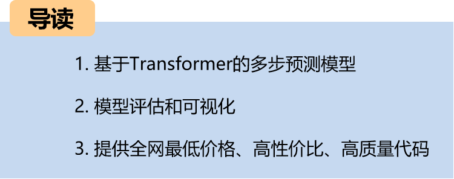
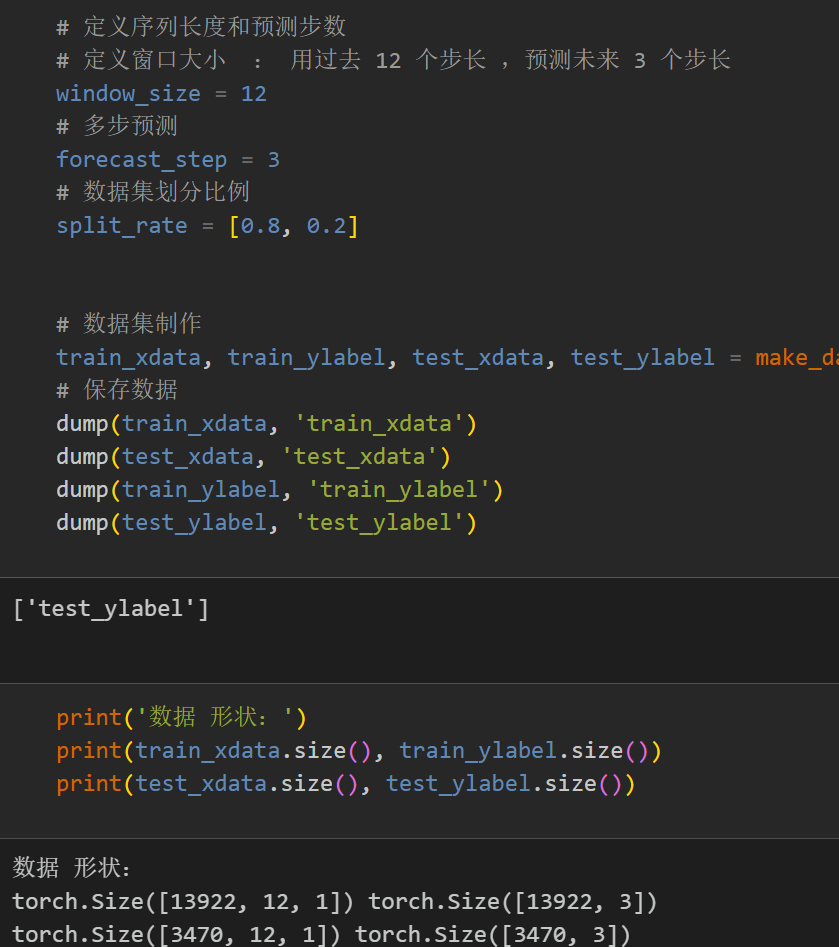
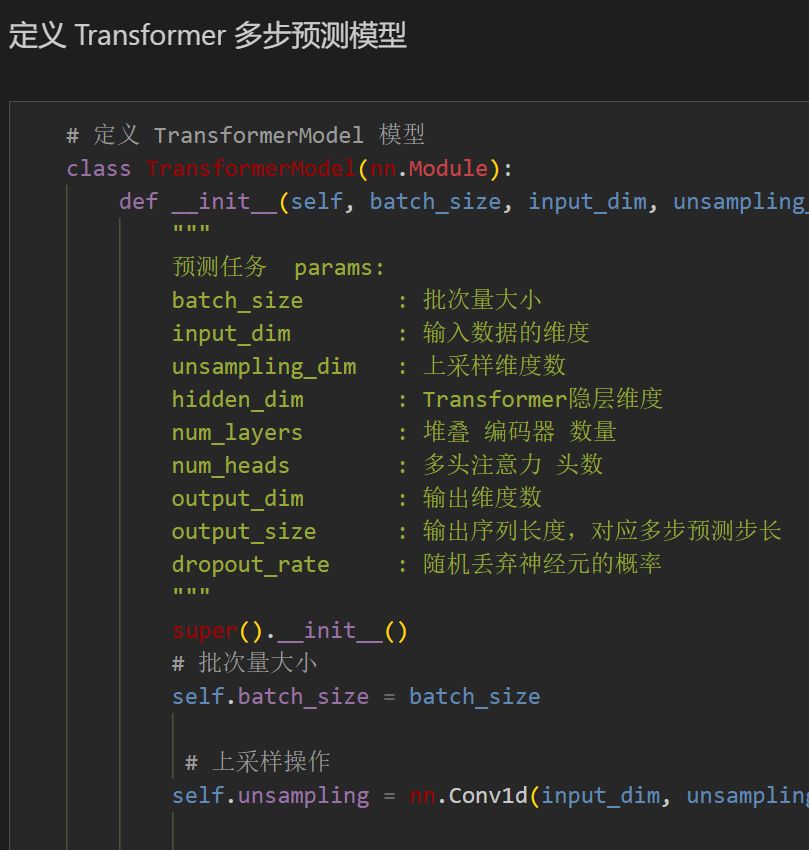
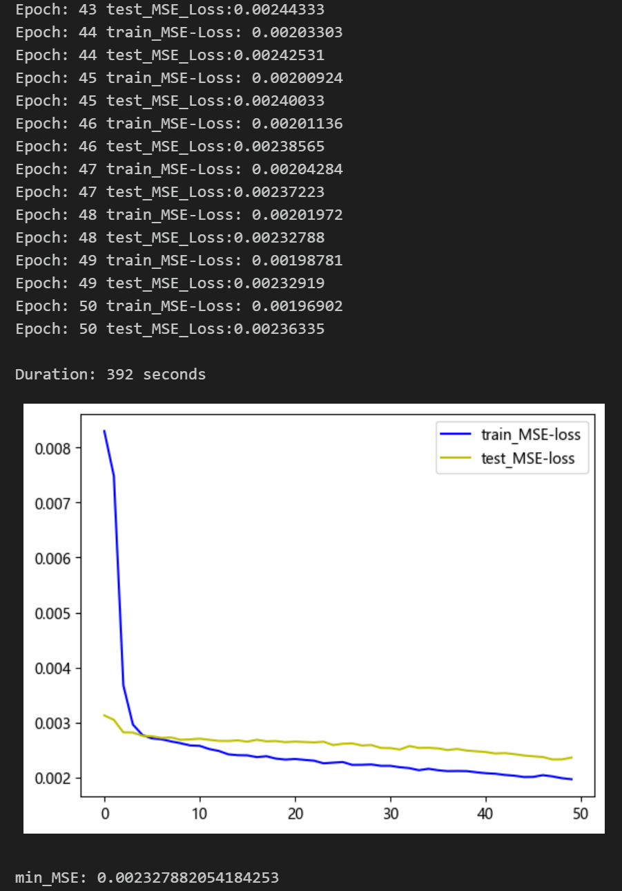
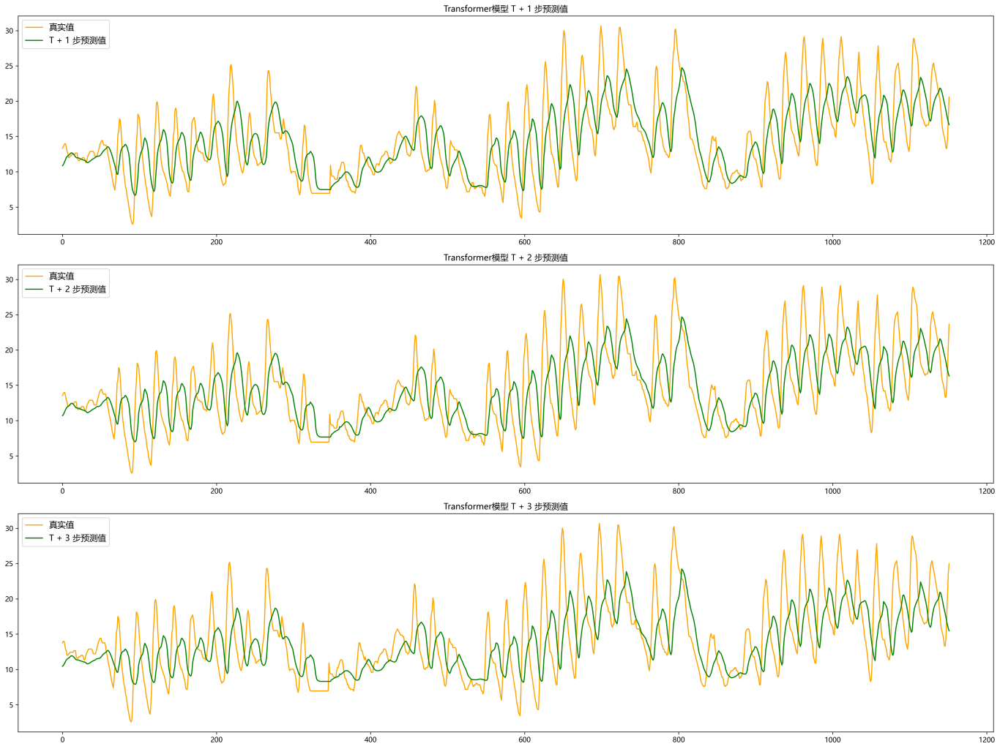
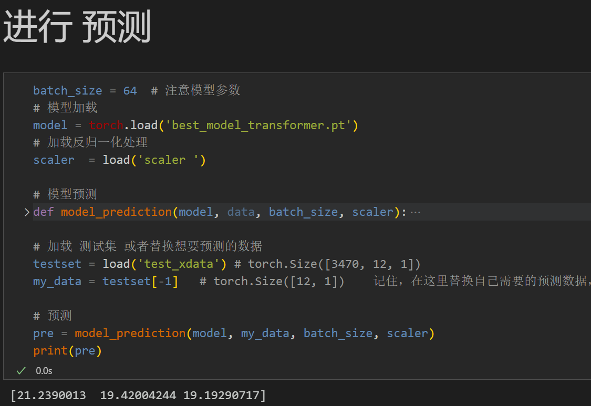
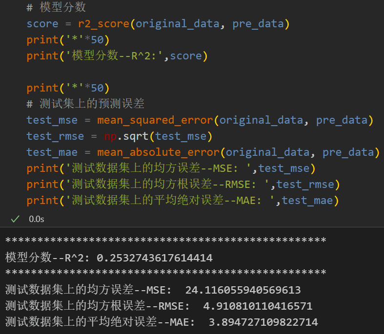
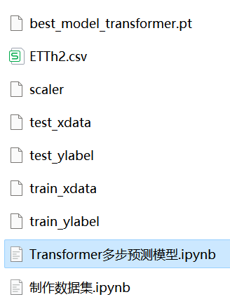

# Multi-step Transformer Prediction Model

1. Environment Framework: Python 3.9, PyTorch 1.8 or later are compatible for execution.
2. User Interface: Paper requirements, graduation design requirements.
3. Code Guarantee: The code is detailed with comments, ready to run without modification.
4. Code and File Introduction:
Preface
This article introduces a multi-step prediction model based on the transformer architecture, following the previous introduction of the power transformer (end of the paper attached to the dataset).
Detailed introduction to the power transformer dataset can be found in the following document:
Power Transformer Dataset Introduction and Preprocessing
1. Data Preprocessing and Visualization of Power Transformer Data
1.1 Importing Data
1.2 Multi-step Preprocessing for Power Transformer
2. Multi-step Prediction Model Based on Transformer
2.1 Definition of Transformer Network Model
2.2 Setting Up Parameters and Training the Model
50 epochs, MSE = 0.002327, the Transformer multi-step prediction model has significantly improved prediction performance. The model can fully extract spatial features from sequences, converges quickly, performs excellently, with high prediction accuracy. By appropriately adjusting model parameters, further improvement in model prediction performance can be achieved.
Note on Parameter Tuning:
Adjustments may include:
- Increasing the number of Transformer encoder layers and attention dimensions;
- Fine-tuning learning rate;
- Adding more epochs (be cautious not to overfit);
- Changing the sliding window length (set an appropriate window length);
3. Results Visualization and Prediction, Model Evaluation
3.1 Prediction Results Visualization
3.2 Loading the Model for Prediction
3.3 Model Evaluation
Time series forecasting: Analysis and comparison of LSTM, ARIMA, Holt-Winters, SARIMA models
Wind speed prediction (I) Data introduction and preprocessing
Wind speed prediction (II) EMD-LSTM model based on Pytorch
Wind speed prediction (III) EMD-LSTM-Attention model
Wind speed prediction (IV) EMD-Transformer model based on Pytorch
Wind speed prediction (V) EMD-CNN-LSTM model based on Pytorch
Wind speed prediction (VI) EMD-CNN-GRU parallel model based on Pytorch
CEEMDAN + combined forecasting model (BiLSTM-Attention + ARIMA)
CEEMDAN + combined forecasting model (CNN-LSTM + ARIMA)
CEEMDAN + combined forecasting model (Transformer - BiLSTM + ARIMA)
CEEMDAN + combined forecasting model (CNN-Transformer + ARIMA)
Multi-feature variable sequence prediction (I) - CNN-LSTM wind speed prediction model
Multi-feature variable sequence prediction (II) - CNN-LSTM-Attention wind speed prediction model
Multi-feature variable sequence prediction (III) - CNN-Transformer wind speed prediction model
Multi-feature variable sequence prediction (IV) Transformer-BiLSTM wind speed prediction model
Multi-feature variable sequence prediction (V) CEEMDAN+CNN-LSTM wind speed prediction model
Multi-feature variable sequence prediction (VI) CEEMDAN+CNN-Transformer wind speed prediction model
Prediction model based on SSA optimized by Sparrow optimization algorithm for CEEMDAN-BiLSTM-Attention
The predictive model based on the optimized algorithm SSA of CEEMDAN-Transformer-BiGRU:
Superior Predictive Model: Secondary Decomposition-Combination Prediction
Multi-feature variable sequence prediction (Part 7): CEEMDAN+Transformer-BiLSTM predictive model
Multi-feature variable sequence prediction (Part 8): Predictive model based on SSA of CEEMDAN-SSA-BiLSTM
Multi-feature variable sequence prediction (Part 11): Predictive model based on Pytorch's TCN-GRU
VMD + CEEMDAN secondary decomposition, CNN-LSTM predictive model
VMD + CEEMDAN secondary decomposition, CNN-Transformer predictive model
VMD + CEEMDAN secondary decomposition, Transformer-BiGRU predictive model
Predictive model based on SSA of CEEMDAN - comprehensive code package
Introduction to the power transformer dataset and preprocessing
 | Sci-Tech 1st Class High Innovation Predictive Model!
END
2. Friends who like this can click to follow, give "Attention" to the article, share in the circle or discuss groups.

## Images

<!-- PAYMENT_BLOCK -->

## Get this dataset

- Payment link (Stripe): [Buy now](https://buy.stripe.com/3cs8yP7sY87d0vu9AB)
- Payment QR code: 

<!-- /PAYMENT_BLOCK -->
